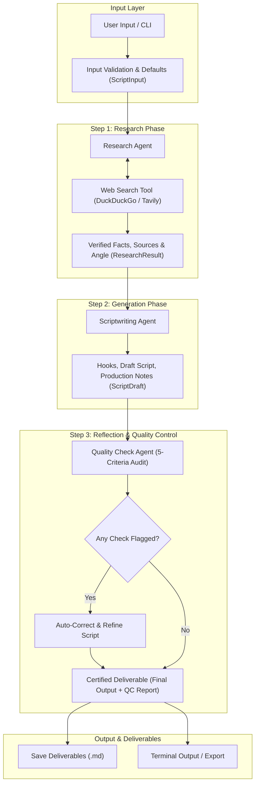

# Tamil Reel Script Agent — Implementation Plan

A comprehensive, production-grade, and clean architecture plan for building the **Tamil Reel Script Agent** for **VG Digital Falcon**, as specified in [`tamil_reel_script_agent_prompt.md`](./tamil_reel_script_agent_prompt.md).

---

## 1. Executive Summary & Specification Analysis

### 1.1 Mission & Role
The **Tamil Reel Script Agent** is an automated short-form video content agent for **VG Digital Falcon**. It transforms any given topic into a research-backed, high-retention, ready-to-record video script optimized for:
* **Instagram Reels**
* **YouTube Shorts**
* **Facebook Reels**

Scripts are delivered in **spoken colloquial Tamil** or **Tanglish**, tailored to exact duration limits and video pacing.

---

### 1.2 Input Schema & Defaults

| Field | Type | Required | Allowed Values / Formats | Default Value |
| :--- | :--- | :---: | :--- | :--- |
| `topic` | `string` | **Yes** | Any topic string | *None (Mandatory)* |
| `audience` | `string` | No | Target demographic / persona | Context-inferred |
| `niche` | `string` | No | Domain / Industry vertical | General Business / Tech |
| `platform` | `enum` | No | `Instagram Reels`, `YouTube Shorts`, `Facebook Reels` | `Instagram Reels` |
| `duration` | `integer` | No | `30`, `45`, `60` (seconds) | `30` |
| `tone` | `enum` | No | `Tamil` (Tamil script), `Tanglish` (English script) | `conversational spoken Tamil` |
| `objective` | `string` | No | `awareness`, `leads`, `followers`, `engagement`, etc. | `awareness` |
| `mode` | `enum` | No | `full_script`, `regenerate_hook`, `regenerate_cta` | `full_script` |

---

### 1.3 Duration Pacing & Word Count Boundaries
Pacing in spoken Tamil/Tanglish averages **~2.2 words per second**. Word limits are strictly enforced:

| Target Duration | Optimal Word Count Range | Tolerance Limit | Structure Breakdown |
| :---: | :---: | :---: | :--- |
| **30 seconds** | **60 – 75 words** | $\pm 5$ words | Hook (10w) + Context (10w) + Body (35w) + Engage (5w) + CTA (10w) |
| **45 seconds** | **95 – 110 words** | $\pm 5$ words | Hook (12w) + Context (15w) + Body (55w) + Engage (8w) + CTA (15w) |
| **60 seconds** | **125 – 145 words** | $\pm 8$ words | Hook (12w) + Context (20w) + Body (75w) + Engage (10w) + CTA (18w) |

---

### 1.4 Strict Output Contract (6 Standard Sections + QC Report)
Every complete run must produce the following exact structure:
1. **Topic & Audience:** Echoes input parameters, target audience, duration, and objective.
2. **Research Summary:** 3–5 bullet points of verified facts, numbers, common mistakes, and the chosen content angle with reasoning.
3. **Hook Options:** 3 hook variations ($\le 12$ words each: question, bold statement, pain-point) with one marked `[RECOMMENDED]`.
4. **Full Script:** Fully formatted with tags: `[Hook]`, `[Context]`, `[Body]`, `[Engagement]`, `[CTA]`, including actual word count.
5. **Production Notes:** 3–5 on-screen text overlays, caption with hashtags, and estimated duration.
6. **Sources:** URL mappings for each factual claim, plus an `Uncertainty / Verify` section for critical claims.
7. **Quality Check Result:** Pass/Flag audit on 5 criteria, with details of any auto-corrections applied.

---

### 1.5 Safety & Integrity Guardrails
* **Zero Hallucination:** Every statistic, salary, visa rule, or job number must map to a verified source URL.
* **Sensitive Topics:** For visas, study abroad, legal, salary, and medical claims: maintain conservative claims, never guarantee outcomes, and append `"Verify on the official site"`.
* **Language Rules:** Strictly conversational spoken phrasing. Reject formal/bookish Tamil (*senthamizh*) or unnatural direct translations.

---

## 2. System Architecture

Per the prompt instruction:
> *"For the assignment, split the prompt into 3 code calls: research -> script -> quality check."*

The architecture separates concerns into 3 distinct, testable agent calls orchestrated by a lightweight pipeline.



---

## 3. Directory & File Structure

```text
Tamil-reel-script-agent/
├── docs/
│   ├── tamil_reel_script_agent_prompt.md   # Original system prompt specification
│   └── implementation_plan.md              # This implementation plan
├── deliverables/                           # Target sample deliverables
│   ├── topic1_website_leads.md             # Topic 1: Business leads from websites
│   ├── topic2_seo_mistakes.md              # Topic 2: Common SEO mistakes
│   └── topic3_germany_visa.md              # Topic 3: Germany Opportunity Card / Visa
├── src/
│   ├── __init__.py
│   ├── config.py                           # Configurations, API keys, word counts
│   ├── models.py                           # Pydantic data schemas
│   ├── search_tool.py                      # Search tool abstraction (DuckDuckGo/Tavily)
│   ├── prompts.py                          # Dedicated system prompts for the 3 steps
│   ├── agents/
│   │   ├── __init__.py
│   │   ├── research_agent.py               # Step 1: Research, facts & angle selection
│   │   ├── script_agent.py                 # Step 2: Hook options, script & production notes
│   │   └── quality_agent.py                # Step 3: 5-point audit & self-correction
│   └── pipeline.py                         # Master orchestrator & regeneration logic
├── main.py                                 # Single-topic CLI runner
├── run_samples.py                          # Batch runner generating all 3 sample deliverables
├── requirements.txt                        # Minimal clean dependencies
├── .env.example                            # Environment variables template
└── README.md                               # Project documentation & run guide
```

---

## 4. Step-by-Step Implementation Roadmap

### Phase 1: Project Setup & Environment
* **Objective:** Establish clean directory structure, dependencies, and configuration.
* **Tasks:**
  1. Create directory structure (`src/`, `src/agents/`, `deliverables/`).
  2. Define `requirements.txt` with minimal, modern packages:
     * `google-genai` or `anthropic` or `openai` (flexible LLM provider)
     * `duckduckgo-search` (free, robust web search without mandatory paid keys)
     * `pydantic` (strict data validation)
     * `python-dotenv` (environment variables)
  3. Create `.env.example` and `src/config.py` handling defaults, model selection, and timing parameters.

---

### Phase 2: Core Data Models & Web Search Wrapper
* **Objective:** Ensure strong typing and safe search capabilities.
* **Tasks:**
  1. **`src/models.py`:**
     * `ScriptInput`: Validates user inputs and fills in defaults (`platform="Instagram Reels"`, `duration=30`, `tone="conversational spoken Tamil"`, `objective="awareness"`).
     * `ResearchResult`: Holds search queries, raw findings, extracted claims, source URLs, and chosen angle.
     * `ScriptDraft`: Holds 3 hooks, hook rationale, labelled script segments, word counts, and production notes.
     * `QualityCheckResult`: Pass/flag list for the 5 criteria and revision log.
     * `FinalDeliverable`: Assembles the 6 required sections + quality check report into markdown.
  2. **`src/search_tool.py`:**
     * Clean function `search_web(query: str, max_results: int = 5) -> List[Dict]`.
     * Strips noise, extracts clean titles, URLs, and snippet texts.

---

### Phase 3: The 3 Modular Agent Steps

#### Step 1: Research Agent (`src/agents/research_agent.py`)
* **Role:** Conduct 3–6 web searches, synthesize verified facts, extract audience pain points, and select one angle.
* **Logic:**
  1. Generate 3–4 search queries tailored to the topic and target audience.
  2. Run queries through `search_tool.py`.
  3. LLM call to extract:
     * 3–5 key facts, statistics, or common mistakes mapped to URLs.
     * 3 distinct audience pain points.
     * Selection of **ONE clear content angle** with a 1-line justification.
     * Mark unsupported claims as `UNVERIFIED` or discard.

#### Step 2: Scriptwriting Agent (`src/agents/script_agent.py`)
* **Role:** Transform research and angle into 3 hooks, a timed script, and production notes.
* **Logic:**
  1. Generate 3 hooks ($\le 12$ words each: question, bold statement, pain-point). Pick one recommended with rationale.
  2. Generate structured script:
     * `[Hook]`: The recommended hook.
     * `[Context]`: Relatable setup (1–2 short sentences).
     * `[Body]`: 3–5 bullet points max. One idea per line.
     * `[Engagement]`: Natural question/comment prompt.
     * `[CTA]`: Specific action matching `objective`.
  3. Enforce tone rules:
     * **Tamil:** Natural colloquial spoken Tamil script (e.g., "பண்ணுங்க", "பாருங்க", not formal "செய்யுங்கள்").
     * **Tanglish:** Spoken Tamil in English script with business/tech words retained in English (e.g., *"Unga website-la traffic varudhu aana leads varala-ya?"*).
  4. Enforce strict word count thresholds based on `duration`.
  5. Generate production notes: 3–5 on-screen text overlays, caption with hashtags, and estimated duration.

#### Step 3: Quality Check & Self-Correction Agent (`src/agents/quality_agent.py`)
* **Role:** Independent reviewer that audits the draft against the 5 criteria and fixes issues before publishing.
* **Audit Checklist:**
  1. **Unsupported Claims:** Does every fact have a source URL?
  2. **Repetition:** Are words or concepts duplicated unnecessarily?
  3. **Weak CTA:** Is the CTA vague ("follow us") or specific to the goal?
  4. **Unnatural Tamil:** Are there formal/bookish words (*senthamizh*), awkward literal translations, or broken grammar?
  5. **Duration Fit:** Does the word count match the duration window?
* **Self-Healing Loop:**
  * If any criteria fails, the agent rewrites the offending section, logs the diff/rationale, and outputs the certified script.

---

### Phase 4: Pipeline Orchestration & Regeneration Modes (`src/pipeline.py`)
* **Objective:** Connect the 3 steps and support targeted regeneration modes without re-doing research.
* **Modes:**
  * **`full_script`**: Runs Step 1 $\rightarrow$ Step 2 $\rightarrow$ Step 3.
  * **`regenerate_hook`**: Reuses existing research and body; only generates 3 new hooks, swaps in the new recommended hook, and verifies word count.
  * **`regenerate_cta`**: Reuses existing research and body; generates 3 new CTAs, swaps in the best CTA, and updates word count.

---

### Phase 5: CLI Interface & Batch Runner
* **Objective:** Provide simple commands to test and generate deliverables.
* **Scripts:**
  1. **`main.py`:**
     * Run with flags: `--topic`, `--audience`, `--duration`, `--tone`, `--mode`.
     * Pretty-prints to console and saves to file.
  2. **`run_samples.py`:**
     * Runs all 3 test cases specified in the assignment:
       * **Sample 1:** Website Leads (Tanglish, 30s, Objective: Agency leads)
       * **Sample 2:** SEO Mistakes (Tamil/Tanglish, 45s, Objective: Awareness)
       * **Sample 3:** Germany Job Seeker / Chancenkarte (Conservative facts, 60s, Objective: Awareness)
     * Saves outputs directly into `deliverables/`.

---

## 5. Quality Assurance Checklist

Before marking the implementation complete, verify:
- [ ] Each topic undergoes **3 distinct code calls** (Research $\rightarrow$ Script $\rightarrow$ QC).
- [ ] DuckDuckGo/Tavily search runs 3–6 queries per topic.
- [ ] Zero unverified claims or fake guarantees appear in scripts.
- [ ] Script word counts fall strictly inside target ranges:
  - 30s: 60–75 words
  - 45s: 95–110 words
  - 60s: 125–145 words
- [ ] Spoken Tamil uses everyday language; Tanglish uses natural phonetics.
- [ ] `regenerate_hook` and `regenerate_cta` work independently without re-searching.
- [ ] All 3 sample deliverables are generated and saved in `deliverables/`.

---

## 6. Execution Timeline & Next Actions

| Step | Action Item | Output File | Status |
| :---: | :--- | :--- | :---: |
| 1 | Plan Creation | `docs/implementation_plan.md` | **Completed** |
| 2 | Base Setup & Models | `requirements.txt`, `src/config.py`, `src/models.py` | Ready to start |
| 3 | Search Tool & Step 1 Agent | `src/search_tool.py`, `src/agents/research_agent.py` | Pending |
| 4 | Step 2 Script Agent | `src/agents/script_agent.py` | Pending |
| 5 | Step 3 Quality Agent | `src/agents/quality_agent.py` | Pending |
| 6 | Orchestrator & CLI | `src/pipeline.py`, `main.py` | Pending |
| 7 | Deliverables Generation | `deliverables/topic[1-3].md`, `run_samples.py` | Pending |
| 8 | Readme & Documentation | `README.md` | Pending |
